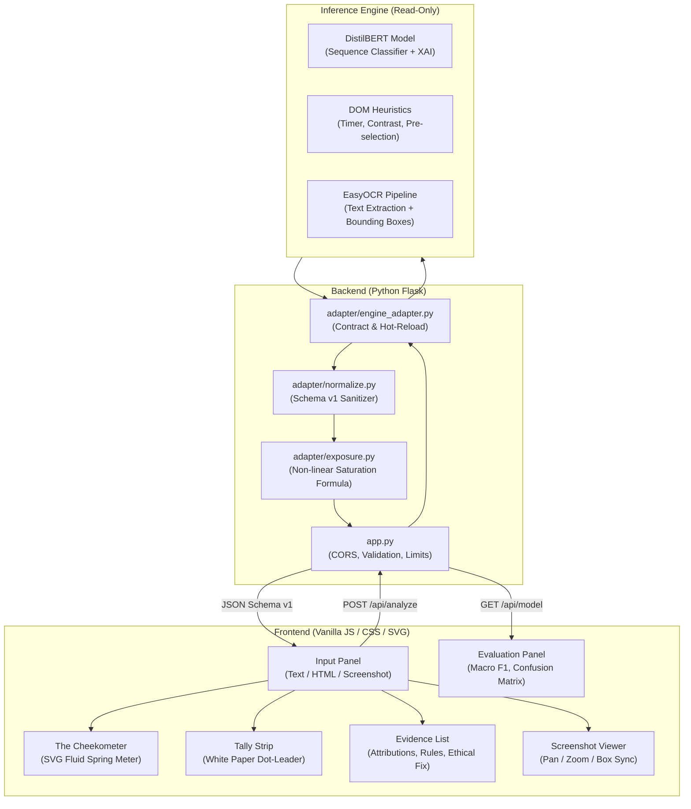

# CheekShield AI — Dark Pattern & Deceptive UI Auditor

**Project for TECHNOVUS &bull; AAYAM XI &bull; National Institute of Technology, Agartala**

[](https://www.python.org/)
[](https://opensource.org/licenses/MIT)
[]()
[]()

> **"Paste a page. Cheeko checks its cheek."**  
> CheekShield AI is a single-page audit tool that scrutinizes e-commerce checkouts, subscription modals, and product listings for deceptive user interface patterns (dark patterns). It combines a fine-tuned DistilBERT transformer with DOM rule heuristics to deliver explainable, calibrated, evidence-backed audits with zero frontend bloat and zero user data retention.

---

## Architecture Overview



---

## Disclosed Dependencies

CheekShield AI discloses all runtime and training dependencies as required:

| Component | Library / Framework | Purpose |
|---|---|---|
| **Web Server** | `Flask` ($\ge 3.0$) | Lightweight, isolated HTTP server handling in-memory audits and static assets |
| **Deep Learning** | `PyTorch` (`torch` $\ge 2.0$) | Neural network runtime for transformer inference |
| **NLP Transformer** | `Hugging Face Transformers` | DistilBERT architecture (`distilbert-base-uncased`) fine-tuned for dark pattern detection |
| **Model Weights** | `safetensors` ($\ge 0.4$) | Fast, secure zero-copy tensor serialization for transformer checkpoints |
| **Vision / OCR** | `EasyOCR` ($\ge 1.7$) | Client-side visual OCR text recognition from screenshots |
| **Computer Vision** | `OpenCV` (`opencv-python-headless` $\ge 4.8$) | Bounding box rendering, image slicing, and coordinate mapping |
| **HTML Parsing** | `BeautifulSoup4` (`bs4` $\ge 4.12$) | DOM tree traversal, pre-selected checkbox detection, and visual asymmetry rules |
| **Image Processing** | `Pillow` (`PIL` $\ge 10.0$) | In-memory image format verification, safe decoding, thumbnail preview |
| **Evaluation Metrics**| `scikit-learn` ($\ge 1.3$) | Precision, recall, macro-F1, and confusion matrix calculation |
| **Data Processing** | `pandas` ($\ge 2.0$) | Dataset structuring and metric tabulation |
| **Testing** | `pytest` ($\ge 7.4$) | Automated test suite execution |

*Note: The frontend has **zero** external libraries, zero frameworks (no React/Vue), zero build steps, and zero CDN links. All SVGs, fonts, and scripts are 100% self-hosted and fully operational offline.*

---

## Setup & Quickstart

### 1. Prerequisites
- Python 3.10, 3.11, 3.12, 3.13, or 3.14.
- Windows, macOS, or Linux.

### 2. Environment Setup
```powershell
# Clone the repository
git clone https://github.com/your-username/cheeksShield.git
cd cheeksShield

# Create a virtual environment
python -m venv .venv

# Activate the virtual environment
# Windows PowerShell:
.\.venv\Scripts\Activate.ps1
# macOS/Linux:
# source .venv/bin/activate

# Install dependencies
pip install -r requirements.txt
```

---

## Model Weights & Placement

### Model Weights Storage Notice
> **Note on Model Weights:** Model weights (`*.safetensors`, `*.bin`, `*.pt`) are large binaries and are **not stored in git** (enforced via `.gitignore`).
>
> **Reviewer Download Link:**
> - Checkpoint Archive: `[DOWNLOAD_LINK_PLACEHOLDER: Insert Google Drive / Hugging Face Release URL here]`
> - Alternatively, configure Git LFS if tracking via Git LFS remote storage.

### How to Place Your Trained Model in `outputs/model/`
Place your fine-tuned model checkpoint bundle directly inside the `outputs/model/` directory (tracked via `outputs/model/.gitkeep`):

```
outputs/model/
├── meta.json                # REQUIRED: Evaluation report, classes, temperature, confusion matrix
├── model.safetensors        # REQUIRED: Weights (or pytorch_model.bin)
├── config.json              # REQUIRED: Hugging Face DistilBERT config
├── tokenizer.json           # REQUIRED: Fast tokenizer definition
├── vocab.txt                # REQUIRED: WordPiece vocabulary
├── tokenizer_config.json    # Tokenizer settings
└── special_tokens_map.json  # Special token mappings
```

#### Required `meta.json` Structure
Your `meta.json` file must contain:
- `classes`: List of classification labels, e.g. `["Urgency", "Scarcity", "Social Proof", "Misdirection", "Other Dark Pattern", "Not Dark Pattern"]`.
- `temperature`: Calibrated temperature scaling parameter (e.g. `1.8`).
- `dark_threshold`: Classification decision threshold (e.g. `0.45`).
- `test_report`: Scikit-learn classification report dictionary with `macro avg` (`f1-score`, `precision`, `recall`) and per-class metrics.
- `binary_report_tuned` or `binary_report`: `{ "threshold": 0.45, "precision": 0.91, "recall": 0.89, "f1": 0.90 }`.
- `confusion_matrix`: $N \times N$ integer matrix where rows = true classes and columns = predicted classes (ordered identical to `classes`).

---

## Preflight Verification Checklist

Before starting the server with a real model, run the preflight verification script:

```powershell
python scripts/preflight.py
```

The preflight script performs non-destructive diagnostics and prints a PASS/FAIL checklist:
1. **Python Dependencies**: Verifies all required libraries import cleanly.
2. **Engine Module**: Confirms `engine/darkpattern_engine.py` exists and exposes all required functions (`predict`, `audit_html_dom`, `analyze_screenshot`, `summarize_findings`, `detect_countdown_timers`, `load_trained_bundle`).
3. **Model Bundle**: Checks `outputs/model/` for `meta.json`, weights (`*.safetensors` or `*.bin`), and tokenizer files (`tokenizer.json` or `vocab.txt`).
4. **EasyOCR Weights**: Checks `~/.EasyOCR/model/` for OCR detector and recognizer weights. If missing, prints the exact command to download them:
   ```powershell
   python -c "import easyocr; easyocr.Reader(['en'])"
   ```
5. **Server Port**: Verifies the configured port (default `5000` or `$env:PORT`) is free.

Every `[FAIL]` line prints the exact remediation command. The script does not load the heavy model into memory unless all files are present.

---

## Running the Application

### A. Real Model Mode (Default: `CHEEK_MOCK=0`)
When your trained model files are placed in `outputs/model/`:
```powershell
python app.py
```
At startup, the server logs a single clear status line:
```
INFO:cheekshield: CheekShield startup: engine=real, model_dir=C:\...\outputs\model, meta.json=found
```
Open your browser to: **`http://127.0.0.1:5000`**  
The header status chip will display **"Model ready"** in green.

### B. Mock Engine Mode (`CHEEK_MOCK=1`)
If you want to review the UI, test interactions, or run automated verification before integrating the real model:
```powershell
# Windows PowerShell:
$env:CHEEK_MOCK = "1"
python app.py

# macOS / Linux / Bash:
# CHEEK_MOCK=1 python app.py
```
At startup, the server logs:
```
INFO:cheekshield: CheekShield startup: engine=mock, model_dir=C:\...\outputs\model, meta.json=not found
```
In mock mode, the header status chip prominently displays **"Mock engine"** so it can never be mistaken for the real trained model.

---

## Sample Inputs Provided

The repository provides ready-to-audit samples in `samples/`:
- **Deceptive Plain Text**: `samples/text_deceptive.txt` — Fake countdown urgency, scarcity, and fabricated social proof.
- **Clean Plain Text**: `samples/text_clean.txt` — Transparent e-commerce delivery timeline, clear return policy.
- **Deceptive HTML DOM**: `samples/html_deceptive.html` — Hidden subscription auto-renewal, pre-ticked add-on checkbox, confirm-shaming opt-out link.
- **Clean HTML DOM**: `samples/html_clean.html` — Transparent headphone product listing with unticked opt-in newsletter checkbox.

Clicking **"Deceptive"** or **"Clean"** under the input box in the web interface instantly loads these samples for one-click auditing.

---

## Running the Automated Test Suite

```powershell
python -m pytest tests/ -v
```

All 83 core tests pass offline. When `outputs/model/` does not contain trained weights, real model inference tests automatically skip with a clear reason:
```
tests/test_api.py::test_real_model_inference SKIPPED (outputs/model/ is empty or missing model files; real model tests skipped.)
```

---

## Demo Replay & Safety Net

In demo mode (`?demo=1`), CheekShield includes an optional safety net governed by `DEMO_REPLAY=1`:
- **Default (`DEMO_REPLAY=0`)**: If the backend engine fails or is unreachable, the system displays the actual error.
- **Demo Replay Active (`DEMO_REPLAY=1`)**: If the engine fails during a live stage demonstration, the system falls back to saved sample results and displays a prominent, unmistakable **"Saved result (demo replay)"** banner and receipt tag on screen. Canned results never appear silently, and never appear when the real engine answers.

---

## Disclaimer

> **Assistive Indication Only:** CheekShield AI provides assistive indications of potentially deceptive or unfair design patterns to aid designers, auditors, and shoppers. Its findings are based on machine learning classifications and heuristic rules; **they do not constitute legal findings or regulatory determinations of illegality**. Every flagged finding warrants human review in context.
