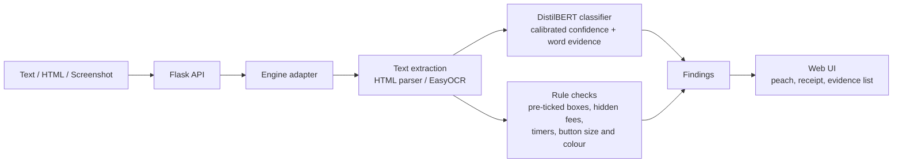

# CheekShield AI: Dark Pattern and Deceptive UI Auditor

TECHNOVUS, AAYAM XI, NIT Agartala. AI & ML track.

[](https://www.python.org/)

> **Cheeko checks the softspots.**
> Paste checkout text, paste page HTML, or upload a screenshot. CheekShield finds manipulative design and shows the evidence for every finding: the category, the original text or screenshot region, a confidence or rule score, a risk level, the words that triggered it, and an ethical fix.

Outputs are assistive indications of potentially deceptive design, not legal findings.

---

## What it does

| Input       | What happens                                                                                                               |
| ----------- | -------------------------------------------------------------------------------------------------------------------------- |
| Pasted text | Split into lines, each line classified by the model                                                                        |
| HTML / DOM  | Visible text classified by the model, plus rule checks on the markup                                                       |
| Screenshot  | EasyOCR reads the text, the model classifies it, and OpenCV rules check buttons and boxes. Findings are drawn on the image |

The result is shown as a peach. If nothing is flagged, the peach stays empty and says **Fresh**. If anything is flagged, the peach fills and pulses, says **Soft spots detected**, and the evidence list below explains each finding. Every finding carries a badge showing whether it came from the **Model** or from a **Rule**, and rule scores are never shown as probabilities.

### Categories

| Category           | Detected by                                                                                                                                                       |
| ------------------ | ----------------------------------------------------------------------------------------------------------------------------------------------------------------- |
| Urgency            | DistilBERT, plus a countdown-timer rule                                                                                                                           |
| Scarcity           | DistilBERT                                                                                                                                                        |
| Social proof       | DistilBERT                                                                                                                                                        |
| Misdirection       | DistilBERT (confirmshaming wording), plus an OpenCV button size and colour check on screenshots                                                                   |
| Preselected choice | HTML `checked` attribute, or an OpenCV checkbox check on screenshots. Paid-looking labels are high risk; routine ones such as "Remember me" are shown as low risk |
| Disguised ad       | Rule check                                                                                                                                                        |
| Other dark pattern | DistilBERT (sneaking, obstruction, forced action)                                                                                                                 |

## Architecture



- The **engine** (`engine/darkpattern_engine.py`) holds the model code and the rule checks. The **adapter** (`adapter/`) is the only code that talks to it and converts its output into one stable JSON format, so the web UI never depends on engine internals.
- To upgrade the model, replace the files in `outputs/model/`. The adapter reloads them without any change to the UI or the API.

### Project layout

```
app.py            Flask server and /api routes
adapter/          Engine adapter, output normalisation
engine/           Model and rule-check code (do not edit)
outputs/model/    Trained model files (weights are downloaded, see below)
static/           Frontend: plain HTML, CSS and JavaScript, no frameworks, no CDN
samples/          Deceptive and clean sample inputs
scripts/          Preflight check
tests/            Automated tests
```

---

## Model and data

- **Model:** `distilbert-base-uncased` fine-tuned as a six-class classifier (Urgency, Scarcity, Social Proof, Misdirection, Other Dark Pattern, Not Dark Pattern). Confidence is temperature-scaled, and each flagged text gets leave-one-out word evidence.
- **Training data:** the [E-Commerce Dark Patterns text dataset](https://github.com/yamanalab/ec-darkpattern) from yamanalab. The dataset is not included in this repository; check its licence upstream before redistributing it.
- **Training recipe:** near-duplicates removed (digits normalised), train/validation/test split by source page group (about 70/15/15) so the same page never appears on both sides, class weights, label smoothing 0.05, AdamW at 3e-5 with 10% warm-up, early stopping on macro-F1, and temperature scaling fitted on the validation set.
- **Screenshot and HTML checks** are rule-based heuristics, not trained models.

### Evaluation (held-out test set)

| Metric                    | Value  |
| ------------------------- | ------ |
| Macro-F1 (6 classes)      | 0.\_\_ |
| Dark vs benign: precision | 0.\_\_ |
| Dark vs benign: recall    | 0.\_\_ |
| Dark vs benign: F1        | 0.\_\_ |

The per-class table and the confusion matrix are shown live in the app's "How good is it?" panel and are stored in `outputs/model/meta.json`. Misclassified examples are in `outputs/model/test_errors.csv`.

### Known limitations

- Genuine low-stock messages and fake scarcity can use identical wording, so text alone cannot always tell them apart.
- Countdown-like text that is not a sales timer (for example delivery cut-off times) can be flagged as urgency.
- A ticked checkbox in a screenshot cannot be told apart from one the user ticked. The HTML `checked` attribute is more reliable.
- Rule-based checks are heuristics, not verified findings. Every flag needs human review.
- Hidden checkout steps cannot be seen from a pasted page or a single screenshot.
- English text only.

---

## Setup

Requires Python 3.10 or newer and about 2 GB of disk space. A GPU is not needed.

```powershell
git clone https://github.com/voldepotter/cheekshield.git
cd cheekshield

python -m venv .venv
.\.venv\Scripts\Activate.ps1          # macOS/Linux: source .venv/bin/activate

pip install -r requirements.txt
```

### 1. Download the model weights

The weights file (`model.safetensors`, about 250 MB) is too large for git, so it is attached to the **v1.0 release**. The small model files (`config.json`, `meta.json`, tokenizer files) are already in `outputs/model/`; only the weights need downloading.

Windows (PowerShell):

```powershell
curl.exe -L -o outputs\model\model.safetensors https://github.com/voldepotter/cheekshield/releases/download/v1.0/model.safetensors
```

macOS / Linux:

```bash
curl -L -o outputs/model/model.safetensors https://github.com/voldepotter/cheekshield/releases/download/v1.0/model.safetensors
```

You can also download it from the [Releases page](https://github.com/voldepotter/cheekshield/releases) and copy it to `outputs/model/model.safetensors`. The SHA-256 checksum is listed in the release notes.

### 2. Download the OCR weights (screenshots only, needs internet once)

```powershell
python -c "import easyocr; easyocr.Reader(['en'])"
```

### 3. Check everything is in place

```powershell
python scripts/preflight.py
```

It prints a PASS/FAIL checklist (packages, engine, model files, OCR weights, port). Every FAIL line says how to fix it.

### 4. Run

```powershell
python app.py
```

Open the address printed at startup (by default `http://127.0.0.1:5000`). The header chip should say **Model ready**. The first audit is slower while the model loads.

Click **Deceptive** or **Clean** under the input box to load a sample, then press **Audit**. Samples are in `samples/`.

### Optional settings

| Variable        | Effect                                                                                                                                                                 |
| --------------- | ---------------------------------------------------------------------------------------------------------------------------------------------------------------------- |
| `MODEL_DIR`     | Use a model folder other than `outputs/model`                                                                                                                          |
| `PORT`          | Change the server port                                                                                                                                                 |
| `CHEEK_MOCK=1`  | Use a fake engine for UI work. The header chip says **Mock engine**, so it can never be mistaken for the real model                                                    |
| `DEMO_REPLAY=1` | If the engine fails, show saved sample results with a visible "Saved result" tag. Off by default; saved results never appear silently or when the real engine answered |

---

## Updating the model

1. Train, and copy the full output folder (weights, `config.json`, tokenizer files, `meta.json`) into `outputs/model/`.
2. The running server detects the change and reloads. The UI and the evaluation panel update by themselves.
3. To share it, commit the small files, upload the new `model.safetensors` as a new GitHub release, and update the version in the download link above.

The weights and `meta.json` must come from the same training run.

Retraining (optional, needs the dataset downloaded separately):

```powershell
python engine/darkpattern_engine.py --data path/to/ec-darkpattern/dataset/dataset.tsv --out outputs/model
```

## Tests

```powershell
python -m pytest tests/ -v
```

Tests that need the real model are skipped automatically when the weights are missing.

---

## Privacy

Everything is processed in memory. Uploaded text, HTML and screenshots are not written to disk, not logged and not shared. No cookies and no third-party requests; fonts and scripts are self-hosted, so the app works offline after setup.

## Dependencies

| Library                                         | Used for                                                        |
| ----------------------------------------------- | --------------------------------------------------------------- |
| Flask                                           | Web server and API                                              |
| PyTorch, Hugging Face Transformers, safetensors | Running the DistilBERT classifier                               |
| EasyOCR                                         | Reading text from screenshots (runs on the server)              |
| OpenCV (headless)                               | Drawing boxes and the button and checkbox checks on screenshots |
| BeautifulSoup4                                  | Parsing HTML, pre-ticked boxes, hidden text                     |
| Pillow                                          | Checking and decoding uploaded images                           |
| scikit-learn, pandas                            | Training and evaluation metrics                                 |
| pytest                                          | Tests                                                           |

Exact versions are in `requirements.txt`. Base model: `distilbert-base-uncased` (Apache-2.0).

## Disclaimer

CheekShield AI provides assistive indications of potentially deceptive design to help designers, auditors and shoppers. Its findings come from a machine-learning model and heuristic rules. They are not legal findings, and every flagged item should be reviewed by a person in context.

## Licence

MIT. See `LICENSE`.
