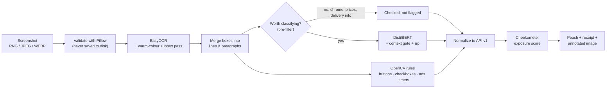
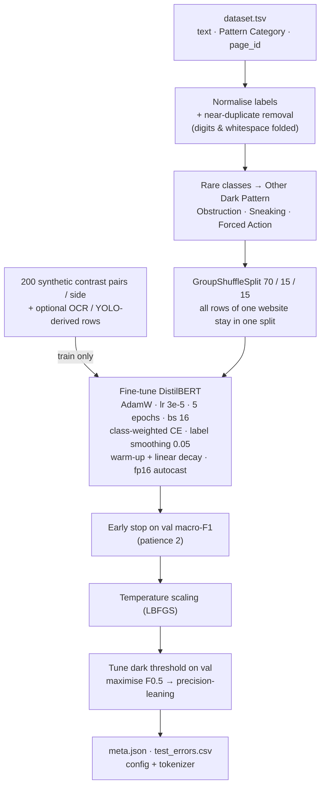

<div align="center">


<br>


**An explainable auditor that finds dark patterns and deceptive UI in e-commerce pages.**
Paste text, drop HTML, or upload a screenshot, and get back _evidence_, not just a score.

[Quickstart](#-quickstart) · [How it works](#-how-it-works) · [The model](#-the-model) · [Results](#-results) · [API](#-api) · [Repo map](#-repo-map)

</div>

---

## 🍑 What is CheekShield?

Ever seen **"Hurry! Only 2 left!"**, a countdown that resets when you refresh, a pre-ticked _"Add order protection"_ box, or a decline button that says **"No thanks, I don't like saving money"**? Those are **dark patterns**: interface tricks that steer people into spending more, subscribing, or sharing data they didn't mean to.

**CheekShield AI** (mascot: _Cheeko the peach_, who "checks the softspots") audits a checkout flow and tells you:

- 🎯 **What** is manipulative (7 pattern categories)
- 🔍 **Why** it was flagged (word-level attributions for ML findings, named rule weights for heuristic findings)
- 🛠️ **How to fix it** (an ethical-design remediation for every category)
- 🍑 **How soft the page is** (the Cheekometer)

It is deliberately honest about what it is. Every flag is worded as _"Likely dark pattern, needs human review (not verified wrongdoing)"_, and rule-based checks are never dressed up as probabilities.

---

## ✨ Feature tour

<div align="center">


</div>

<sub>Left: idle. Right: after auditing the built-in _Deceptive_ sample, the peach fills and pulses. Screenshots were captured from the running UI on the built-in demo engine (`CHEEK_MOCK=1`), because trained weights aren't committed to git. With the trained model loaded, findings come from DistilBERT.</sub>

### Three ways in

| Input             | What happens                                                                                                                                           |
| ----------------- | ------------------------------------------------------------------------------------------------------------------------------------------------------ |
| 📝 **Text**       | Checkout copy, popups, or product-page text is split into lines and classified by the fine-tuned DistilBERT model.                                     |
| 🧩 **HTML**       | A DOM auditor inspects _attributes and styles_ (pre-checked boxes, tiny or faded fee text) and then classifies the visible text.                       |
| 🖼️ **Screenshot** | OCR plus OpenCV finds text, timers, ticked checkboxes, lopsided buttons and fake ads, and returns an **annotated image** (red = dark, green = benign). |

### Seven categories, each with an explanation and an ethical fix

|     | Category               | Typical example                                          | Evidence               |
| :-: | ---------------------- | -------------------------------------------------------- | ---------------------- |
| ⏱️  | **Urgency**            | "Offer ends in 04:59", `00h 26m 43s` countdowns          | Model + timer rules    |
| ⏳  | **Scarcity**           | "Only 2 left in stock", "selling fast"                   | Model                  |
| 👥  | **Social Proof**       | "8 people are viewing this right now"                    | Model                  |
| ↗️  | **Misdirection**       | Confirmshaming, oversized _Accept_ vs. dim _Decline_     | Model + visual rules   |
| ☑️  | **Preselected Choice** | Pre-ticked paid add-ons, donations, newsletters          | Rules (DOM and pixels) |
| 🏷️  | **Disguised Ad**       | Promo styled as a nav link or a fake system notification | Rules (OpenCV)         |
| ⚠️  | **Other Dark Pattern** | Hidden fees, auto-renew in 9 px grey text                | Model + DOM rules      |

### Evidence you can actually read

<div align="center">

</div>

Each card shows the source (**Model** or dashed **Rule** chip), calibrated confidence, the highlighted words that drove the prediction, a plain-English explanation, and a collapsible **Ethical fix**. In screenshot mode, hovering a finding highlights its bounding box on the image, and vice versa.

---

## 🧭 How it works

<div align="center">

</div>

The core design rule is that **two kinds of evidence are kept strictly separate**:

|                 | 🧠 Learned evidence                               | 📐 Rule evidence                                           |
| --------------- | ------------------------------------------------- | ---------------------------------------------------------- |
| Produced by     | Fine-tuned DistilBERT                             | DOM inspector and OpenCV/OCR checks                        |
| Score means     | Temperature-calibrated probability                | A heuristic score, _not_ a probability                     |
| Explained with  | Leave-one-out **Δp** per word                     | Named **rule weights** (e.g. `checked`, `Area Ratio 2.1x`) |
| In the UI       | Solid **Model** chip, percentages                 | Dashed **Rule** chip, raw weights only                     |
| Tag in the data | `source_type: "NLP Text Classifier (DistilBERT)"` | `source_type: "… (Rule-Based Heuristic)"`                  |

### Life of a screenshot audit



---

## 🧠 The model

|                   |                                                                                                                                                                              |
| ----------------- | ---------------------------------------------------------------------------------------------------------------------------------------------------------------------------- |
| **Backbone**      | `distilbert-base-uncased` (6 layers · 12 heads · 768 hidden · ~66M params)                                                                                                   |
| **Head**          | `DistilBertForSequenceClassification`, 6 classes                                                                                                                             |
| **Classes**       | `Misdirection` · `Not Dark Pattern` · `Other Dark Pattern` · `Scarcity` · `Social Proof` · `Urgency`                                                                         |
| **Input**         | A single UI string, tokenized to a max of 64 tokens                                                                                                                          |
| **Base data**     | The e-commerce dark-pattern corpus from [`yamanalab/ec-darkpattern`](https://github.com/yamanalab/ec-darkpattern) (`dataset.tsv`). Our engine is an upgrade of that project. |
| **Calibration**   | Temperature scaling, **T = 0.56**, fitted on the validation set                                                                                                              |
| **Decision rule** | Flag as dark when `P(dark) = 1 − P(Not Dark Pattern)` exceeds a tuned threshold (**τ = 0.90**)                                                                               |

### Training recipe (`python engine/darkpattern_engine.py`)



A few decisions worth calling out:

- **Split by website, not by row.** `GroupShuffleSplit` keeps every snippet from the same site in the same split, so the test set measures _generalisation to unseen shops_, not memorisation of one shop's phrasing.
- **Synthetic hard negatives teach "pressure wording, not topic".** The generator emits benign look-alikes ("Delivery by 17 Nov, Mon", "4.3 out of 5 (2,314 ratings)", "Offer valid till 28 Nov") next to dark twins ("Hurry! Offer ends in 3 hours", "Only 2 left in stock"). They go into **train only**, so validation and test numbers stay comparable with the original dataset.
- **Screenshots can become training data.** `--build_from_images` OCRs a folder of screenshots into a TSV (labelled benign or auto-predicted), and `--build_from_yolo` converts a YOLO-format dark-pattern dataset into text rows. Both feed back via `--extra_data`.
- **Precision-leaning threshold.** The threshold is picked with **F0.5** on validation, so a false alarm costs more than a miss. Auditors lose trust fast when a tool cries wolf.
- **Per-surface floors.** The effective threshold is `max(meta.dark_threshold, floor)` with floors of `text 0.50 · html 0.65 · screenshot 0.80`. OCR text is noisier, so screenshots get a stricter bar.

### Guard rails around the model

1. **Pre-filter.** Breadcrumbs, prices, ratings, "Add to cart", plain delivery info and very short fragments never reach the classifier. They are recorded as _checked_, not flagged.
2. **Context gate.** A flagged category is kept only if the wording that defines it is actually present (Urgency needs deadline or countdown language, Social Proof needs crowd or popularity language, Misdirection needs shaming language, and so on). A very confident (P(dark) ≥ 0.97), full-sentence (5+ words) prediction of _Misdirection_ or _Other_ can bypass the gate.
3. **OCR typo repair.** `OOh 26rn 435` becomes `00h 26m 43s` before timer matching.

### Explainability: leave-one-out Δp

For each flagged line, CheekShield masks **one word at a time**, re-scores the sentence, and reports how much the predicted-class probability fell:

```
Δp(word) = max(0, p_base − p_without_word)
```

The UI highlights words with opacity proportional to Δp, so _"Hurry!"_, _"Only"_, _"2 left"_ light up in `Hurry! Only 2 left in stock.` Highlighting is done with safe text-node splitting, never `innerHTML`.

---

## 📊 Results

Held-out **test set: 321 snippets** from websites never seen in training (metrics read straight from `outputs/model/meta.json`).

<div align="center">

|  Accuracy  | Macro-F1  | Dark-vs-benign precision | Dark-vs-benign recall | Dark-vs-benign F1 |
| :--------: | :-------: | :----------------------: | :-------------------: | :---------------: |
| **94.1 %** | **0.910** |        **0.977**         |       **0.929**       |     **0.952**     |

</div>

<sub>Dark-vs-benign figures use the tuned threshold τ = 0.90. With a plain argmax the same model scores P 0.949 · R 0.936 · F1 0.942, so tuning trades about 0.7 points of recall for about 2.8 points of precision.</sub>

<div align="center">

</div>

| Category           | Precision | Recall |    F1     | Test support |
| ------------------ | :-------: | :----: | :-------: | :----------: |
| Misdirection       |   0.829   | 0.853  |   0.841   |      34      |
| Not Dark Pattern   |   0.951   | 0.961  |   0.956   |     181      |
| Other Dark Pattern |   0.700   | 0.875  |   0.778   |      8       |
| Scarcity           | **1.000** | 0.968  | **0.984** |      31      |
| Social Proof       | **1.000** | 0.929  |   0.963   |      42      |
| Urgency            |   0.958   | 0.920  |   0.939   |      25      |

<div align="center">

</div>

**Reading the results honestly**

- Scarcity, Social Proof and Urgency are the model's strongest classes. Their wording is distinctive.
- **Misdirection ↔ Not Dark Pattern** is the main confusion (5 errors each way). Upsell copy like _"Don't forget the essentials: get AppleCare+"_ sits right on the line between persuasion and manipulation.
- **Other Dark Pattern** has only 8 test examples, so its 0.778 F1 is a noisy estimate. Every misclassified test example is listed in [`outputs/model/test_errors.csv`](outputs/model/test_errors.csv).
- The Preselected Choice, Disguised Ad and visual-Misdirection detectors are **rule-based**, so they have no test-set F1 and are labelled as heuristics everywhere.

---

## 🍑 The Cheekometer

Every flagged finding adds _pressure_ to the page, weighted by its risk tier and strength, and a saturating curve turns pressure into a 0–100 **exposure** score:

```
pressure = Σ  tier_weight × strength          tier_weight: High 1.0 · Medium 0.6 · Low 0.3
percent  = round( 100 × (1 − e^(−pressure / K)) )          K = 1.6  (tunable via EXPOSURE_K)
```

<div align="center">

</div>

| Exposure | Band             |
| :------: | ---------------- |
|   0 %    | 🟢 **Fresh**     |
|  1–24 %  | 🍑 Slight bruise |
| 25–49 %  | 🍑 Soft spots    |
| 50–74 %  | 🔥 Squishy       |
| 75–100 % | 💥 Rotten        |

Two guards keep the number honest: a _clean_ result is always forced to 0 %, and any page with at least one flag is never shown as 0 %. The curve **saturates**, so ten flags can't push the score past 100 % and a single strong flag already registers clearly. The API returns the full `exposure` object, while the on-screen peach shows the clear two-state outcome (empty _Fresh_ vs. full and pulsing _Soft spots detected_), driven by `summary.flagged_items`.

---

## 🔬 The rule engines in detail

<details>
<summary><b>📐 DOM / HTML inspector</b></summary>

- Strips `script`, `style`, `noscript`, `head` and **hidden elements** (`hidden`, `display:none`, `visibility:hidden`), so only what a shopper can see is judged.
- **`<input type="checkbox" checked>`** is read together with its label. A paid-sounding label (fee, protection, insurance, warranty, newsletter, donation, subscription, `₹ $ € £` …) is a **High-risk Preselected Choice**, while a routine one ("Remember me") is recorded as a benign pre-selection and not flagged.
- **Hidden-cost text**: fee, renewal, trial or cancellation wording rendered at ≤ 10 px, opacity ≤ 0.35, or with a WCAG contrast ratio below 2:1 becomes an _Other Dark Pattern_ finding with the exact reasons attached.
- Remaining text is split into lines and sentences, deduplicated, capped at 300, and classified by DistilBERT. A countdown-timer detector then runs on every line.

</details>

<details>
<summary><b>👁️ Screenshot / visual inspector</b></summary>

- **High-recall OCR**: EasyOCR with boosted contrast, plus a second pass that finds _small warm-coloured text strips_ (e.g. a 9 px orange `Order in 00h 26m 43s`), enhances their contrast, upscales 2.5× and re-reads them.
- **Box merging**: word boxes → rows → wrapped paragraphs, while keeping timer lines separate from delivery headers.
- **Button asymmetry** (visual Misdirection): pairs an _accept_ CTA with a nearby _decline_ CTA and flags the pair when the accept side has ≥ 1.45× the visual footprint **or** ≥ 45 more colour saturation. Phrases like "no hidden fees" are excluded from the decline matcher.
- **Pre-ticked checkbox detector**: finds small, near-square contours, then analyses the interior pixel geometry to tell a real tick (✓) or cross (✕) from an empty box, and reads the label to its right.
- **Disguised ads**: (1) an _ad / sponsored / giveaway_ link styled identically to the real nav links in the top band, and (2) a **floating promo card** styled like a system notification, found by scoring promo words, CTA buttons, missing ad labels, drop-shadows and overlap with page content.
- **Countdown timers**: 3-unit (`00h 26m 43s`), 2-unit, 1-unit with deadline wording (`Order in 22 minutes`) and clock (`04:59`) timers, with negative filters for video durations, cook times and "posted 3 hours ago".

</details>

---

## How we implemented transfer learning

We use transfer learning in the standard Hugging Face way: start from a pretrained DistilBERT, attach a new classification head, and fine-tune the whole thing on the dark-pattern dataset.

1. Pretrained starting point (in `train()`)
   ```python
   tok = AutoTokenizer.from_pretrained(a.model) # default: "distilbert-base-uncased"
   model = AutoModelForSequenceClassification.from_pretrained(
    a.model, num_labels=len(classes)).to(dev)
   ```

- **Reused from pretraining:** the tokenizer, the word embeddings and the 6 transformer blocks. DistilBERT already understands English and how words relate before it sees a single dark pattern.
- **New and randomly initialised:** the classification head. This is the pre-classifier layer (768→768) plus the output layer (768→6) for our six categories.

1. **Full fine-tuning, not a frozen feature extractor**
   ```python
   opt = torch.optim.AdamW(model.parameters(), lr=a.lr, weight_decay=0.01)
   ```

**3. Settings that protect the pretrained knowledge**

- **Low learning rate:** `3e-5`. The head starts random, and large steps would erase what the encoder already knows.
- **10% warm-up, then linear decay** of the learning rate.
- **Gradient clipping** at 1.0.
- **Early stopping** on validation macro-F1 (patience 2, max 5 epochs). The best checkpoint is saved and reloaded for the final evaluation.

**4. Adapting to our data**

- Class-weighted loss with label smoothing 0.05, so the rare classes aren’t drowned out by benign text.
- Website-level split, so we measure transfer to unseen sites rather than memorised templates.
- Temperature scaling after training, so the confidences are calibrated on the new task.

**5. Reuse at inference**  
The fine-tuned weights and tokenizer are saved to `outputs/model/`. `load_trained_bundle()` loads them once and caches them, so every audit reuses the trained model without retraining.

**Other pretrained pieces**

- **EasyOCR** is a pretrained model used as-is for inference. We don’t fine-tune it.
- **OpenCV** is rule-based, so there is no learning there.
- **YOLO** (future) would follow the same pattern: start from pretrained weights and fine-tune the final layers on UI-component screenshots.

---

## 🔌 API

Served by Flask (`app.py`). Everything is analysed **in memory**.

| Method | Endpoint                  | Purpose                                                                                                     |
| ------ | ------------------------- | ----------------------------------------------------------------------------------------------------------- |
| `POST` | `/api/analyze`            | JSON `{"mode": "text" or "html", "content": "…"}` **or** multipart `mode=screenshot` + `file`               |
| `GET`  | `/api/health`             | `ready` / `warming` / `model_missing` / `error`, engine `real` or `mock`, OCR readiness                     |
| `GET`  | `/api/model`              | Classes, temperature, threshold, per-class report and confusion matrix (drives the _How good is it?_ panel) |
| `GET`  | `/api/samples`            | Built-in deceptive and clean samples                                                                        |
| `POST` | `/api/admin/reload-model` | Reload the engine (localhost only, or `Authorization: Bearer $ADMIN_TOKEN`)                                 |

<details>
<summary><b>Example</b></summary>

```bash
curl -s localhost:5000/api/analyze -H 'Content-Type: application/json' \
  -d '{"mode":"text","content":"Hurry! Only 2 left in stock.\nNo thanks, I prefer paying full price."}'
```

```jsonc
{
  "api_version": "1",
  "mode": "text",
  "summary": {
    "status": "flagged",
    "overall_risk": "High Risk",
    "flagged_items": 2,
    "by_category": { "Scarcity": 1, "Misdirection": 1 },
  },
  "exposure": {
    "percent": 78,
    "band": "rotten",
    "label": "Rotten",
    "pressure": 2.4,
  },
  "findings": [
    {
      "id": "f1",
      "kind": "flag",
      "category": "Scarcity",
      "evidence_kind": "model",
      "risk_label": "High Risk",
      "score": 0.96,
      "score_label": "Confidence",
      "p_dark": 0.98,
      "attributions": [
        { "token": "Hurry!", "weight": 0.31, "unit": "delta_p" },
      ],
      "explanation": "Creates artificial fear of missing out (FOMO)…",
      "how_to_fix": "Show actual verified inventory counts calmly…",
      "verdict": "Likely dark pattern - flagged by model/heuristic, needs human review (not verified wrongdoing)",
    },
  ],
}
```

_(Illustrative values. A screenshot request also returns `screenshot.annotated`, a JPEG data-URL with the drawn boxes.)_

</details>

**A thin adapter layer owns the contract.** `adapter/engine_adapter.py` is the _only_ file that imports the engine. It adds a global lock around the shared torch model and OCR reader, a background **warm-up thread**, mtime-based **hot-reload** (swap in new weights, touch `meta.json`, and `/api/model` plus inference update with zero code changes), and a mock-engine switch. `adapter/normalize.py` smooths every engine quirk (duplicate `confidence`/`heuristic_score`, `delta_p`/`rule_weight`, pre-filter stubs, benign pre-selections, unknown categories) into one stable **API v1** shape.

---

## 🚀 Quickstart

```bash
git clone https://github.com/voldepotter/cheekshield.git
cd cheekshield
python -m venv .venv && source .venv/bin/activate      # Windows: .venv\Scripts\activate
pip install -r requirements.txt
```

### 1 · Just look at the UI (no model, no torch needed at runtime)

```bash
CHEEK_MOCK=1 python app.py          # Windows PowerShell: $env:CHEEK_MOCK=1; python app.py
# → http://localhost:5000   (header chip shows “Mock engine”)
```

### 2 · Run with the real model

Model **weights are not committed** (`*.safetensors` etc. are git-ignored); `meta.json`, tokenizer and config are. Either drop your trained weights next to them in `outputs/model/`, or train your own:

```bash
# get yamanalab/ec-darkpattern's dataset.tsv, then:
python engine/darkpattern_engine.py --data ec-darkpattern/dataset/dataset.tsv --out outputs/model
python scripts/preflight.py          # PASS/FAIL checklist: engine, model bundle, packages, EasyOCR weights, port
python app.py
```

Try the engine straight from the CLI:

```bash
python engine/darkpattern_engine.py --predict "Hurry! Only 2 left in stock." "No thanks, I prefer paying full price."
```

### Configuration

| Variable               | Default                     | What it does                                                                                               |
| ---------------------- | --------------------------- | ---------------------------------------------------------------------------------------------------------- |
| `CHEEK_MOCK`           | `0`                         | `1` uses the mock engine (UI dev and demos). The header chip says so when active.                          |
| `MODEL_DIR`            | `outputs/model`             | Where `meta.json` and the weights live                                                                     |
| `ENGINE_MODULE`        | `engine.darkpattern_engine` | Swap in a different engine                                                                                 |
| `EXPOSURE_K`           | `1.6`                       | Steepness of the Cheekometer curve                                                                         |
| `DEMO_REPLAY`          | `0`                         | On engine failure, serve a clearly labelled **“Saved result”** instead of an error (stage-demo safety net) |
| `ADMIN_TOKEN`          | unset                       | Allows remote `/api/admin/reload-model`                                                                    |
| `PORT` · `FLASK_DEBUG` | `5000` · `0`                | Server options                                                                                             |

**Limits** (all in `config.py`): 20,000 characters of text · 300 lines per audit · images up to 8 MB (PNG / JPEG / WEBP, shrunk to 2000 px on the long side) · HTML size capped by `MAX_HTML_BYTES` · 30 requests/min per IP.

### Tests

```bash
pytest -q
```

90+ tests cover the API contract, normalisation edge cases, the exposure maths (including both guard rails), the model-swap hot-reload drill, and Phase 7 hardening. Tests that need the real model **skip with a clear reason** if `outputs/model/` has no weights, instead of crashing.

---

## 🔒 Privacy & safety by design

- **Nothing is stored.** Text, HTML and screenshots are processed in memory, never written to disk or logged. Scratch files only ever go to the OS temp dir and are cleaned up.
- **Zero third-party calls.** No CDNs, cookies or trackers. The CSP is `default-src 'self'` and fonts use fallback stacks.
- **XSS-resistant.** Attributions render through text nodes, and the "ethical comparison" mocks use static templates with no user data inside.
- **Hardened inputs.** Pillow-verified image types (not file extensions), a decompression-bomb pixel cap, size limits and rate limiting.
- **Honest wording.** _"Not a legal finding."_ is stamped on every receipt. Unknown risk strings default to **Low Risk** instead of being hidden.
- **Accessible.** 44 × 44 px touch targets, 16 px inputs (no iOS zoom), keyboard-operable tabs and `prefers-reduced-motion` support.

## ⚠️ Known limitations

- Genuine low-stock notices and fake scarcity can use identical wording.
- A ticked checkbox in a screenshot can't be told apart from one the user ticked.
- Rule-based checks are heuristics, not verified findings.
- Hidden checkout steps aren't visible from a single input.
- English only.

---

## 🗂️ Repo map

```text
cheekshield/
├── app.py                      # Flask entry point: routes, CSP, rate limit, input validation
├── config.py                   # env-driven settings: limits, exposure K, bands, thresholds
├── engine/
│   └── darkpattern_engine.py   # training CLI + DistilBERT inference + XAI + DOM & OpenCV auditors
├── adapter/
│   ├── engine_adapter.py       # the only engine importer: lock, warm-up, hot-reload, dispatch
│   ├── normalize.py            # raw engine findings → stable API v1 shape
│   ├── exposure.py             # Cheekometer score (pure function)
│   └── mock_engine.py          # torch-free engine for UI work and demos
├── outputs/model/              # meta.json · config.json · tokenizer · test_errors.csv  (weights git-ignored)
├── static/                     # zero-build frontend
│   ├── index.html · css/       # design tokens, layout, components, print stylesheet
│   ├── assets/                 # logo and SVG icon sprite
│   └── js/                     # ES modules (below)
├── samples/                    # deceptive + clean text and HTML demo inputs
├── scripts/preflight.py        # PASS/FAIL environment checklist
├── tests/                      # pytest suite (API, contract, exposure, normalize, model swap, hardening)
├── DECISIONS.md                # 42-entry log of design choices
└── docs/img/                   # images used in this README
```

<details>
<summary><b>Frontend modules (<code>static/js/</code>)</b></summary>

| File                  | Role                                                                               |
| --------------------- | ---------------------------------------------------------------------------------- |
| `main.js`             | Boots the app and wires input, audit flow, states and keyboard shortcuts           |
| `input.js`            | Text / HTML / screenshot tabs, drag-drop and paste upload, validation              |
| `meter.js`            | The animated peach: spring-physics fill, slosh, bubbles, clean-state tick          |
| `peachfield.js`       | Canvas background of drifting peaches (30 fps, reduced-motion aware)               |
| `findings.js`         | Evidence cards, word highlighting, filters, sorting, category chips                |
| `viewer.js`           | Annotated screenshot viewer: zoom, pan, numbered boxes, two-way box ↔ finding sync |
| `tally.js`            | The receipt: per-category rows, risk notches, totals                               |
| `export.js`           | JSON download (image optional), print-to-PDF, copy summary                         |
| `categories.js`       | Single source of truth for categories, icons and descriptions                      |
| `api.js` · `state.js` | Fetch layer (90 s timeout, request sequencing) and shared app state                |
| `canned_results.js`   | Labelled saved results, used **only** when `DEMO_REPLAY=1`                         |

</details>

<details>
<summary><b>Highlights from <code>DECISIONS.md</code></b></summary>

- **#9, #41, #42**: a clean result gets its own _Fresh_ state, and the percentage ticks were replaced by a clear two-state peach.
- **#12**: rule findings show raw rule weights as dashed chips, _never percentages_. Heuristics aren't probabilities.
- **#20**: PDF export is pure `@media print` CSS, so there is no JS PDF dependency.
- **#27, #30**: a demo mode (`Alt+D` or `?demo=1`) plus a `DEMO_REPLAY` safety net that is always visibly labelled.
- **#31–#33**: mock mode is OFF by default and clearly badged, `preflight.py` diagnoses the environment, and real-model tests skip gracefully.
- **#37**: a multi-layer bug fix (stale animation state, missing request sequencing) so the meter can never show a stale percentage.

</details>

---

## 🏁 Built at TECHNOVUS

CheekShield AI was built for the **AI/ML track at TECHNOVUS · Aayam XI, NIT Agartala**.

<!-- TEAM: add member names and links here -->

**Credits.** The dark-pattern text corpus and the original baseline come from [yamanalab/ec-darkpattern](https://github.com/yamanalab/ec-darkpattern). The classifier builds on [DistilBERT](https://huggingface.co/distilbert-base-uncased) via 🤗 Transformers, with [EasyOCR](https://github.com/JaidedAI/EasyOCR), [OpenCV](https://opencv.org/) and [BeautifulSoup](https://www.crummy.com/software/BeautifulSoup/) for the screenshot and DOM auditors.

<div align="center">

<sub>🍑 Outputs are assistive indications of potentially deceptive design, **not legal findings**. Every flagged item warrants human review.</sub>

</div>
